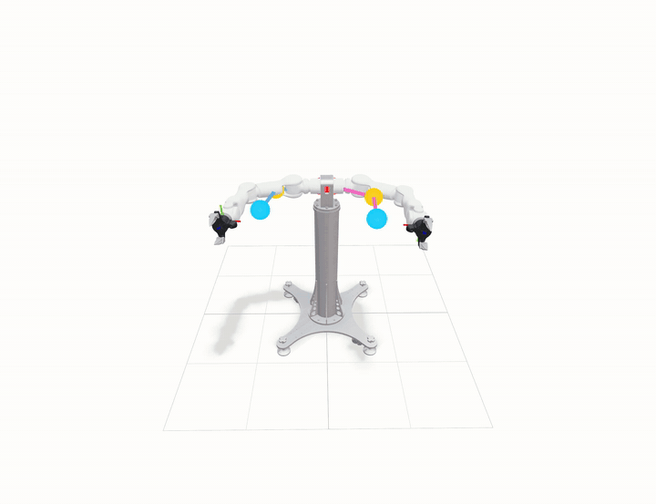

# SEW-Mimic Retargeting

[](https://github.com/chase6305/SEW-mimic-retargeting/actions/workflows/ci.yml)

Closed-form seven-DoF arm retargeting in Python and optional C++, based on
*A Closed-Form Geometric Retargeting Solver for Upper Body Humanoid Robot Teleoperation*.
Matches upper-arm/forearm directions and hand orientation. Includes Marvin M6 and OpenArm
assets, interactive demos, and a capsule/XPBD bimanual self-collision filter.

## Marvin M6 demo



From a source checkout, with Python 3.10+:

```bash
pip install -e '.[visualization,safety]'
python -m examples.demo_robot_viser --robot marvin
```

Open **http://localhost:8080**. The demo loops a 60-second dual-arm motion with playback controls,
joint sliders, human keypoints, and coordinate frames. It uses synthetic reachable targets;
no tracking device or robot connection is required.

To compare an unsafe target with the filtered command:

```bash
python -m examples.demo_robot_collision_avoidance --robot marvin
```

Open **http://localhost:8081**. Red translucent meshes show the target; the solid robot shows the
filtered command. The command holds when correction fails and resumes when the target is safe.

Both demos accept `--robot openarm`, `--backend cpp`, and `--help`.
The motion demo also accepts `--side left|right|both`.

## Use the solver

For the solver alone, install with `pip install -e .`.

```python
import numpy as np

from sew_mimic import solve
from sew_mimic.robots import load_robot_arm

arm = load_robot_arm("marvin", side="left")
q_command = solve(
    arm.robot,
    np.zeros(7),                    # current joints, radians
    np.array([0.0, 0.0, 0.0]),     # shoulder
    np.array([0.20, 0.20, 0.05]),   # elbow
    np.array([0.45, 0.25, 0.10]),   # wrist
    np.eye(3),                     # hand orientation, SO(3)
    backend="python",
)
```

All positions and the hand rotation must use the same arm-base frame (`left_arm_base` for this
Marvin arm); positions use metres and joints use radians. Limb vectors must be nonzero.
The objective matches directions and orientation rather than absolute tool position.

Build the optional native backend, then select `backend="cpp"` or pass `--backend cpp` to a demo:

```bash
SEW_MIMIC_BUILD_CPP=1 pip install -e '.[cpp]'
sew-mimic-info --validate-robots
```

The default backend is Python (overridable with `SEW_MIMIC_BACKEND`); selecting C++ requires the
extension and fails if it is unavailable. Robot URDFs and meshes are bundled in wheels.

## Documentation

- [Usage](docs/usage.md): backend selection, batch solving, input frames, and collision filtering.
- [Robot integration](docs/robot-integration.md): adapters, landmarks, registration, and validation.
- [VR and tracking](docs/vr-integration.md): calibration, smoothing, recording, and replay.
- [Architecture](docs/architecture.md): prepared kinematics and real-time execution.
- [Performance measurements](docs/performance-2026-09-05.md): measured scope and reproduction commands.
- [Development](docs/development.md): checks, packaging, and paper reproduction notes.

The solver currently supports the paper's parallel-wrist path. The collision filter uses approximate
self-collision capsules and heuristic XPBD; it has no formal collision-avoidance guarantee and does
not model environment obstacles. Hardware engagement, command limits, and emergency stops belong
to the application.

## Citation

```bibtex
@article{kong2026closed_form_geometric_retargeting,
  author  = {Kong, Chuizheng and Cho, Yunho and Jung, Wonsuhk and
             Wibowo, Idris and Shinde, Parth and Vinodh-Sangeetha, Sundhar and
             Chung, Long Kiu and Chen, Zhenyang and Mattei, Andrew and
             Nidumukkala, Advaith and Elias, Alexander and Xu, Danfei and
             Higgins, Taylor and Kousik, Shreyas},
  title   = {A Closed-Form Geometric Retargeting Solver for Upper Body
             Humanoid Robot Teleoperation},
  journal = {arXiv preprint arXiv:2602.01632},
  year    = {2026},
  doi     = {10.48550/arXiv.2602.01632}
}
```
